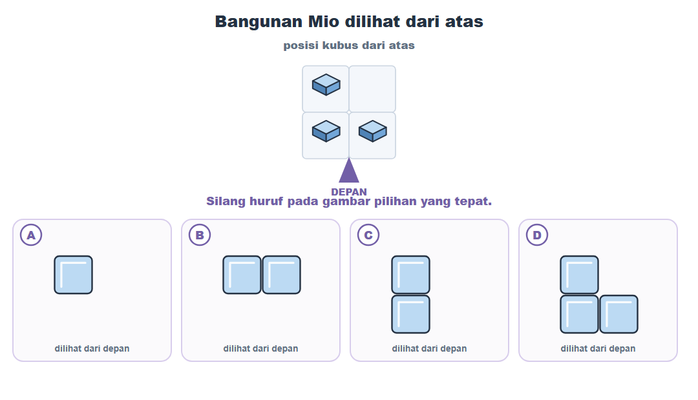
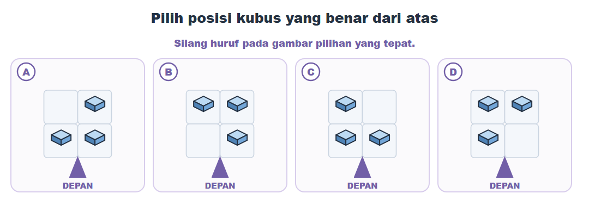
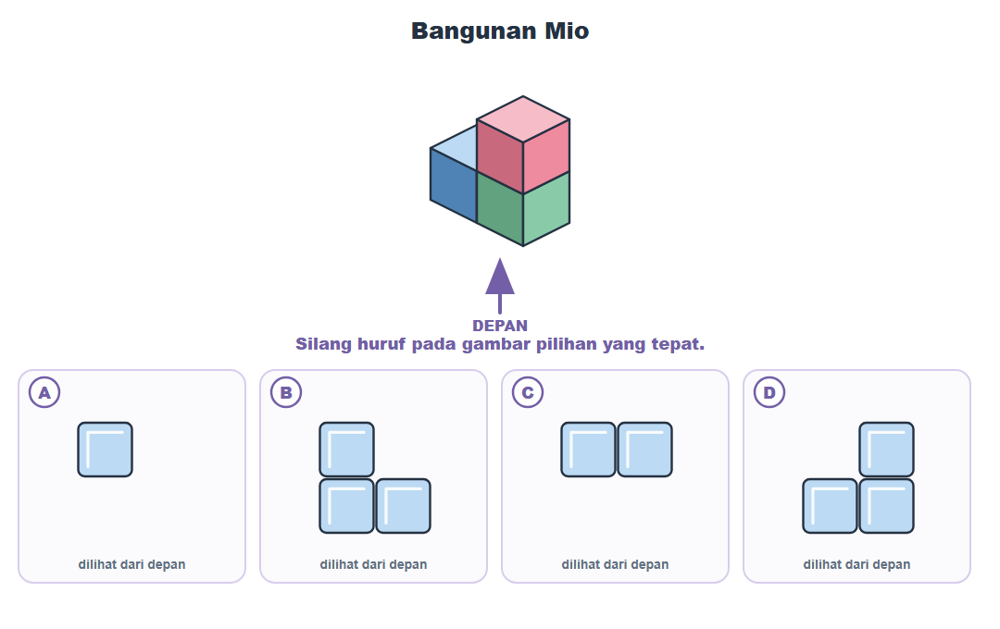
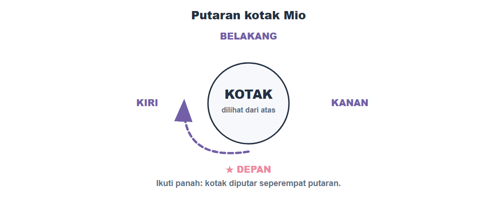
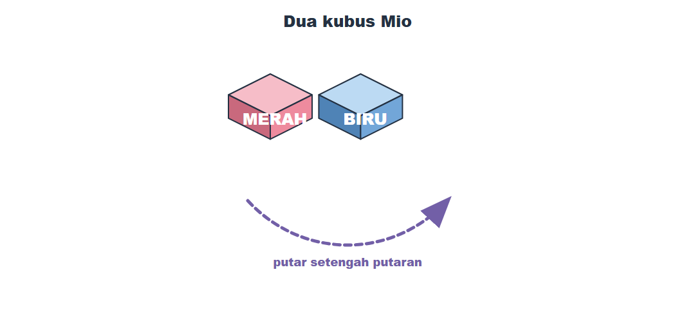
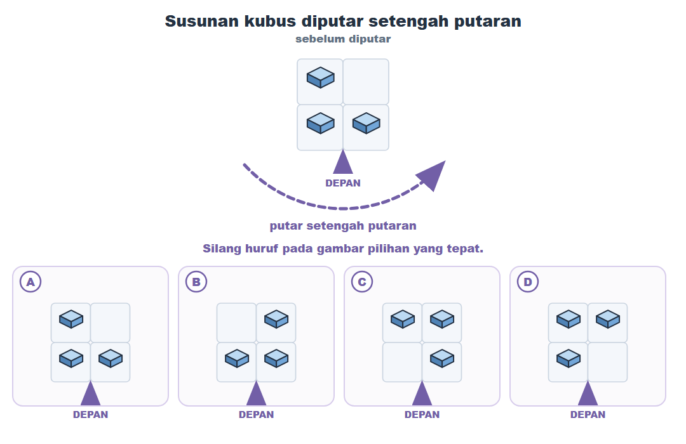
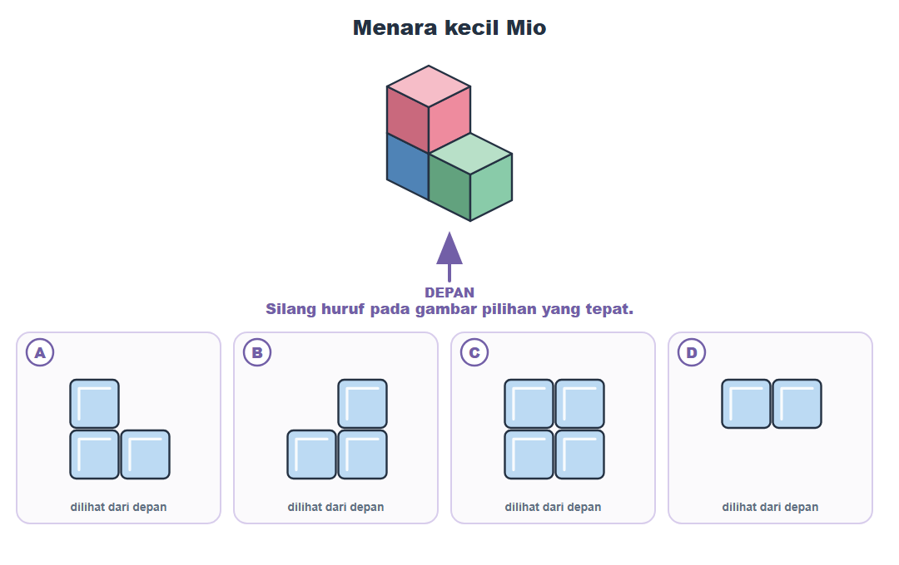
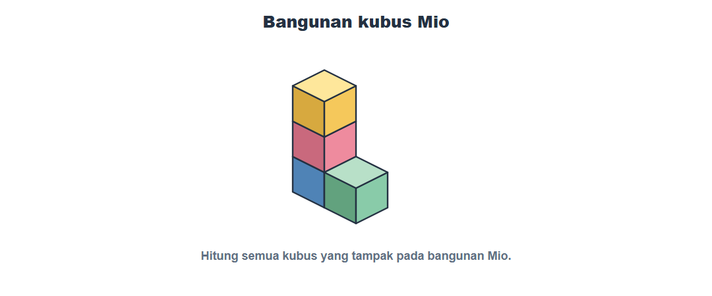
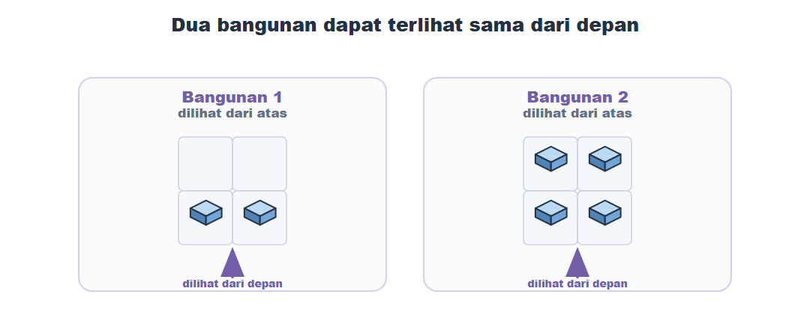
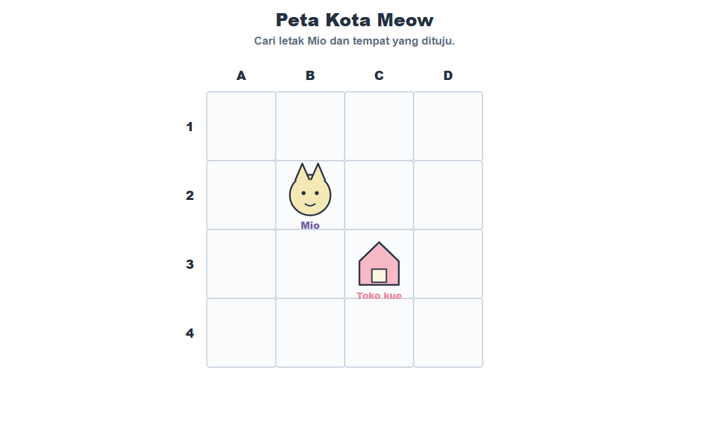

# Pretest Kemampuan Spasial MeowMath
## Paket A — Kelas VI

| Nama / kode peserta | ______________________________________________ |
| --- | --- |
| Kelas | ____________________ |
| Sasaran | Murid Kelas VI / Fase C |

## Petunjuk

1. Baca satu soal, lalu amati gambarnya dengan tenang.
2. Pilih satu jawaban yang paling tepat.
3. **Silang huruf A, B, C, atau D langsung pada pilihan jawaban.**
4. Tidak perlu terburu-buru. Kamu boleh membuat coretan kecil di kertas soal.

## 1. Bangunan dari depan

Mio menyusun tiga kubus seperti pada gambar. Jika Mio melihat bangunan itu dari **depan**, gambar manakah yang akan ia lihat?

## 2. Menaruh tiga kubus

Mio ingin menaruh tiga kubus: satu di **kiri belakang**, satu di **kiri depan**, dan satu di **kanan depan**. Gambar dari atas manakah yang sesuai?

## 3. Menara kanan

Mio membuat dua kubus berdampingan. Lalu ia menaruh satu kubus tepat di atas kubus sebelah kanan. Jika dilihat dari depan, gambar manakah yang benar?

## 4. Bintang yang berputar

Bintang berada di sisi **depan** kotak Mio. Ikuti arah panah pada gambar. Setelah kotak diputar seperempat putaran, bintang berada di sisi mana?

**○ A. sisi kanan**  
**○ B. sisi belakang**  
**○ C. sisi kiri**  
**○ D. sisi depan**

## 5. Kubus merah dan biru

Kubus merah berada di sebelah kiri kubus biru. Mio memutar susunan itu setengah putaran mengikuti panah. Sekarang kubus merah berada di mana terhadap kubus biru?

**○ A. di sebelah kiri kubus biru**  
**○ B. di sebelah kanan kubus biru**  
**○ C. di depan kubus biru**  
**○ D. di belakang kubus biru**

## 6. Bentuk L setelah diputar

Susunan kubus pada gambar dilihat dari atas. Mio memutarnya setengah putaran. Pilih gambar susunan yang benar setelah diputar.

## 7. Menara kecil

Mio menyusun dua kubus berdampingan, lalu menaruh satu kubus tepat di atas kubus sebelah kiri. Jika dilihat dari depan, gambar manakah yang benar?

## 8. Menghitung kubus

Hitung semua kubus pada bangunan Mio di bawah ini. Ada berapa kubus?

**○ A. 3 kubus**  
**○ B. 4 kubus**  
**○ C. 5 kubus**  
**○ D. 6 kubus**

## 9. Dua bangunan, satu tampak

Perhatikan dua bangunan dari atas. Jika Mio melihatnya dari depan, kedua bangunan tampak sama. Pernyataan manakah yang tepat tentang susunan kubusnya?

**○ A. Kedua bangunan memiliki jumlah kubus yang sama.**  
**○ B. Bangunan 2 memiliki satu baris kubus tambahan di belakang.**  
**○ C. Bangunan 1 lebih tinggi daripada Bangunan 2.**  
**○ D. Bangunan 1 memiliki kubus lebih banyak daripada Bangunan 2.**

## 10. Posisi Mio pada peta

Gunakan peta ini untuk nomor 10, 11, dan 12. Mio berada di kotak mana?

**○ A. A2**  
**○ B. B2**  
**○ C. B3**  
**○ D. C2**

## 11. Jalan Mio

Dari tempatnya, Mio berjalan satu kotak ke kanan, lalu dua kotak ke bawah. Mio berhenti di kotak mana?

**○ A. B4**  
**○ B. C3**  
**○ C. D4**  
**○ D. C4**

## 12. Arah menuju toko kue

Toko kue berada di C3. Dari posisi Mio, toko kue berada di arah mana?

**○ A. kiri dan atas**  
**○ B. kanan dan atas**  
**○ C. kanan dan bawah**  
**○ D. kiri dan bawah**

**Kamu sudah selesai. Periksa sekali lagi jawaban yang sudah kamu silang.**
